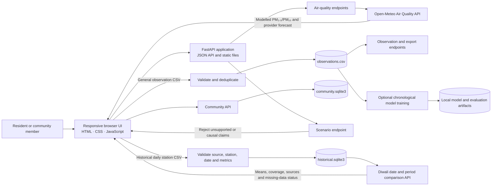

# VAYURAKSHAK AI

**A clear, consumer-friendly guide to air quality around Diwali.** VAYURAKSHAK AI helps residents understand available air-quality information, compare source-labelled daily observations around Diwali, and coordinate practical community activities.

> **MVP data status:** Live PM₂.₅ and PM₁₀ values and forecasts come from Open-Meteo modelled grid estimates, not CPCB monitors. Historical comparisons use station-level records that a user imports. No historical pollutant readings are bundled with this repository, and AQI is shown only when valid AQI data is imported.

## Problem and product goal

Air-quality information can be difficult to interpret when families are planning outdoor activities around Diwali. Users need a plain-language view that distinguishes measurements from model estimates and forecasts, makes missing historical data visible, and avoids claiming that a single event caused an observed change.

**Product goal:** Make available air-quality information understandable and actionable while being explicit about its source, coverage, and limits.

**Primary users:** Residents and families checking local conditions; community members planning low-waste celebrations and local activities; reviewers evaluating an early air-quality product prototype.

## Phase 1 feature scope

The MVP focuses on a feasible, transparent end-to-end product slice:

- **Home and air check:** Show the latest available PM₂.₅ estimate, explain that it is modelled, and label forecast information as a prediction. AQI remains unavailable when the source does not provide valid AQI.
- **Diwali comparison:** Select a city, station, two or more years, and equal-sized windows before and after Diwali. Compare PM₂.₅, PM₁₀, and AQI only when present. Charts and tables expose period coverage, source, station, date range, and missing observations.
- **Data import:** Validate general observation CSVs and historical daily station CSVs separately. The historical importer rejects future dates, invalid pollutant values, and invalid AQI values; duplicate station/day records do not overwrite existing observations.
- **Community:** Local groups, pledges, challenges, events, and posts support participation. Points record participation only; they do not measure pollution reduction.
- **Transparency:** Source labels, unavailable states, descriptive summaries, and model limitations are visible in the interface and documentation.

### Why this MVP is distinct and feasible

The product puts data honesty in the main user flow: it distinguishes model estimates, forecasts, and imported observations; shows pollutant-specific coverage; and leaves missing values blank. Its first version is feasible to demo with a single FastAPI service, static browser assets, local CSV/SQLite storage, and one external forecast provider. Historical comparison works with a validated import path while a complete, licensed station archive is still being established.

### Out of scope for this MVP

There is no live CPCB station/API integration, verified national historical dataset, AQI calculation engine, authenticated user system, staffed moderation operation, operational pollution alerting, or validated causal digital twin. The station view lists imported station metadata; it is not a live geospatial pollution map. Unsupported intervention scenarios are rejected instead of being given invented results.

## Architecture



See [docs/architecture.md](docs/architecture.md) for component responsibilities, data flows, and architecture decisions.

## Technology

- **Frontend:** Static HTML, CSS, and browser JavaScript; responsive layouts; SVG for the Diwali comparison chart.
- **Backend:** Python 3.10+ and FastAPI, served locally with Uvicorn.
- **External air data:** Open-Meteo Air Quality API for modelled grid estimates and provider forecasts.
- **Persistence:** CSV for general imported observations; SQLite for historical Diwali observations and community activity.
- **Optional model workflow:** pandas, NumPy, scikit-learn Random Forest, and joblib for local training/evaluation artifacts. A trained model is not represented as a validated intervention model or as the live provider forecast.

## Run locally

```sh
cd backend
python -m venv .venv
source .venv/bin/activate       # Windows: .venv\Scripts\activate
pip install -r requirements.txt
uvicorn app.main:app --reload
```

Open <http://127.0.0.1:8000>. Interactive API documentation is at <http://127.0.0.1:8000/docs>.

By default, the app requests air-quality data for Delhi. To change the provider location, set these environment variables before starting Uvicorn:

```sh
export VAYU_LATITUDE=19.0760
export VAYU_LONGITUDE=72.8777
export VAYU_LOCATION="Mumbai"
```

Internet access is needed for Open-Meteo. If the provider is unavailable, the interface reports unavailable data; local CSV workflows remain available.

## Data workflows

### General observations and optional model evaluation

The general observation importer accepts a CSV with required headers `timestamp,pm25,pm10`. Optional columns are `temperature,humidity,wind_speed,rainfall,station,latitude,longitude`. Timestamps must be ISO 8601 and PM values use µg/m³. Valid records are saved to `backend/data/observations.csv`.

To run the optional model-training workflow, from `backend/`:

```sh
python -m app.ml.train
```

Training requires sufficient valid records (at least 30) and reports chronological holdout metrics only when evaluation is possible. Model and metric artifacts are kept under `backend/models/` and are ignored by Git.

### Historical Diwali observations

The Diwali importer accepts one row per city, station, and date. Required columns are `date,city,station` and at least one of `pm25,pm10,aqi`; `timestamp` is accepted instead of `date`. PM values use µg/m³. AQI must be an integer from 0 to 500. Leave unavailable values blank. Dates after the current local date are rejected; duplicate city/station/date rows do not replace earlier rows. Records are saved in `backend/data/historical.sqlite3`.

Choose at least two years and the same number of calendar days before and after each reference Diwali date. Diwali day is shown as its own period. Each pollutant has its own valid-day count. The chart leaves unavailable points missing; missing data is never treated as zero. Comparisons and summaries are descriptive and do not establish that fireworks caused an observed change.

The reference sources do not establish a complete PM₂.₅/PM₁₀/AQI series for every requested city, station, and Diwali period. The OGD catalog page describes SO₂, NO₂, RSPM, and SPM and lists a 2017 update; RSPM/SPM are not silently relabelled as PM₁₀. Review and retain the source name and URL for every imported dataset. The app records source labels as supplied; it does not independently verify them.

- [CPCB National AQI Dashboard](https://app.cpcbccr.com/AQIIndia)
- [OGD Historical Daily Ambient Air Quality dataset](https://tn.data.gov.in/catalog/historical-daily-ambient-air-quality-data)

## Repository layout

```text
.
├── README.md
├── docs/
│   └── architecture.md
└── backend/
    ├── app/
    │   ├── data/       # CSV and SQLite persistence/validation
    │   ├── ml/         # Optional training and evaluation workflow
    │   ├── static/     # Browser UI
    │   └── main.py     # FastAPI routes and app setup
    ├── data/           # Local runtime data (ignored by Git)
    ├── models/         # Local model artifacts (ignored by Git)
    ├── requirements.txt
    └── tests/           # Backend regression tests
```

## Data, privacy, and scientific limits

- Open-Meteo values are modelled grid estimates, **not CPCB station measurements**. Review [the Air Quality API documentation](https://open-meteo.com/en/docs/air-quality-api) and [Open-Meteo terms](https://open-meteo.com/en/terms) before deployment; the free service is intended for non-commercial use.
- No CPCB station API integration or complete national historical archive is included.
- AQI is not inferred from incomplete pollutant values or an unsupported averaging period.
- Forecasts are predictions; they are never shown as historical measurements.
- Community profiles are self-selected and there is no sign-in or identity verification. Local SQLite is not a production identity or moderation system.
- SQLite databases, uploaded images, CSV observations, and trained artifacts are local runtime data and are excluded from the repository.

## Phase 1 completion snapshot

- Problem, intended users, MVP boundaries, stack, and system architecture are documented.
- FastAPI service, responsive UI, imports, local persistence, and core prototype flows are present in the repository.
- Architecture diagram and setup guide are documented here and in `docs/architecture.md`.
- Git repository: <https://github.com/chahat-codes/VayuRakshak> (`main`).

## Next evaluation questions

1. Which cities and CPCB stations should be prioritized for a verified historical-data pipeline?
2. What source/API licensing and update process will support repeatable historical imports?
3. Which community features require accounts, moderation, and privacy controls before public deployment?
4. What user testing will validate that people understand model estimates, forecasts, and missing measurements?
