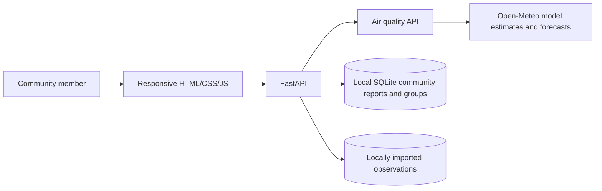

# VAYURAKSHAK AI

A small, transparent community air-quality app. The interface keeps four useful areas: **Home**, **Know Your Community**, **AQI Prediction**, **My Reports**, and **Settings**.

## What it does

- **Home:** Shows the latest available air information and recent community reports.
- **Know Your Community:** Browse environmental issue reports, add a report, respond that you observed or dispute it, and find or add a local group.
- **AQI Prediction:** Shows available PM₂.₅ and PM₁₀ information and provider forecasts. AQI appears only when the source supplies a value. The default live source is Open-Meteo modelled grid data, not a monitoring-station observation.
- **My Reports:** Tracks reports submitted from the current browser profile and shows status history.
- **Settings:** Stores a display name for that browser profile and explains the configured air-data location.

## Run locally

```sh
cd backend
python -m venv .venv
source .venv/bin/activate       # Windows: .venv\Scripts\activate
pip install -r requirements.txt
uvicorn app.main:app --reload --host 127.0.0.1 --port 8001
```

Open <http://127.0.0.1:8001>. API documentation is at <http://127.0.0.1:8001/docs>.

The default provider location is Delhi. Configure it before starting the server:

```sh
export VAYU_LATITUDE=19.0760
export VAYU_LONGITUDE=72.8777
export VAYU_LOCATION="Mumbai"
```

## Report workflow and limits

Reports are stored in the local SQLite database and receive a reference such as `VAYU-000001`. Similar recent reports can be suggested, but are never merged automatically. Users can respond that they observed or dispute a report; those profile responses are not independent verification. A volunteer may accept a report, mark an action as started, and submit a resolution photo. Submitted evidence is not verified by an authority.

Groups are community-submitted and not independently verified. There is no sign-in, secure identity, staffed moderation, municipal authority integration, SMS/push alerting, AI image classification, or automatic action verification. Report locations are rounded before storage/display in the public report view. The local coordinate plot is not a street map, and the app does not send report coordinates to an external map provider.

Air information is labelled **Observed**, **Estimated**, **Forecast**, or **Unavailable**. Open-Meteo estimates are modelled grid values, not CPCB station readings. Forecasts are kept separate from past values. No AQI is inferred from PM values. If the provider is unavailable and no local observation is available, the app shows an unavailable state rather than inventing data.

## Data and storage

The app keeps existing local databases and imported files in place. Runtime community data and uploaded images are stored under `backend/data/`. AQI station observations from a locally supplied CSV may be shown as observed values; source and station coverage depend on what has actually been imported. No complete verified city-wide historical archive is bundled.

## Architecture



## Tests

From `backend/`:

```sh
python -m unittest discover -s tests -v
```
