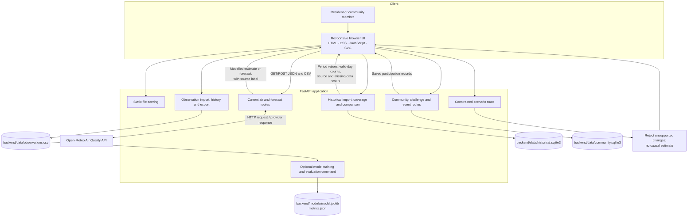

# VAYURAKSHAK AI — System Architecture

## System context

VAYURAKSHAK AI is a local-first prototype for consumer air-quality awareness around Diwali. A browser UI communicates with one FastAPI application. The backend obtains modelled air-quality estimates and forecasts from Open-Meteo, accepts user-supplied observations, computes transparent comparisons, and stores community participation locally.

## Architecture diagram

## Component responsibilities

| Component | Responsibility | Current implementation |
|---|---|---|
| Browser UI | Show air status, forecasts, Diwali comparisons, community pages, and unavailable states | Static HTML/CSS/JavaScript under `backend/app/static/`; responsive CSS; SVG chart |
| FastAPI application | Serve UI and provide JSON/import endpoints | `backend/app/main.py`; local API docs at `/docs` |
| Provider adapter | Request current and forecast pollutant estimates | Open-Meteo Air Quality API; location via `VAYU_LATITUDE`, `VAYU_LONGITUDE`, `VAYU_LOCATION` |
| Observation store | Validate general timestamped PM₂.₅/PM₁₀ imports and expose history/export | CSV at `backend/data/observations.csv` |
| Optional ML workflow | Train and chronologically evaluate a Random Forest from imported records when data is sufficient | `backend/app/ml/`; local artifacts under `backend/models/` |
| Historical Diwali store | Save imported daily city/station observations and compare reference windows | SQLite at `backend/data/historical.sqlite3`; daily records include PM₂.₅, PM₁₀, AQI, source, and source URL |
| Community store | Save groups, memberships, pledges, challenges, events, feed activity, and reports | SQLite at `backend/data/community.sqlite3`; images under `backend/data/uploads/` |
| Scenario route | Enforce limits on unsupported what-if requests | Rejects emission-reduction/unsupported weather perturbations; does not claim a causal digital twin |

## Data flows

### Current conditions and forecast

1. The browser requests `/api/air-quality/latest`.
2. FastAPI requests PM₂.₅ and PM₁₀ from Open-Meteo for the configured coordinates.
3. The UI labels values as modelled grid estimates and shows the provider timestamp. AQI remains unavailable because no AQI source/value is supplied by this integration.
4. Tomorrow's forecast is separately labelled as a prediction. Provider failure produces an unavailable state rather than a substituted value.

### General observation import and optional model evaluation

1. A user uploads a general observation CSV to `/api/data/import`.
2. The backend validates timestamps and non-negative finite PM values and writes accepted rows to `observations.csv`.
3. The optional `python -m app.ml.train` workflow can train/evaluate when sufficient data exists and saves local artifacts.
4. The current UI does not present the trained model as an operational causal intervention model or substitute it for the Open-Meteo provider forecast.

### Historical Diwali comparison

1. A user selects city, station, years, and an equal number of days around each reference festival date.
2. A user-supplied daily CSV is validated and stored in `historical.sqlite3`; future observations and invalid values are rejected, and duplicates are not used to overwrite an existing daily record.
3. The comparison endpoint returns day ranges, descriptive metric summaries, valid-day counts, source names/URLs, and missing-day warnings.
4. The UI charts before / Diwali day / after values for selected years. Missing values stay missing; forecast values are not included.

### Community participation

Browser requests to community endpoints save participation records to a local SQLite database. Pseudonyms and display names are user-selected. The prototype does not authenticate users, verify event organisers, or operate a staffed moderation queue.

## Key architecture decisions

- **One small service for the MVP:** FastAPI serves both the static UI and JSON APIs to keep the prototype easy to run and demo.
- **Keep data types separate:** Provider model estimates, imported station observations, forecasts, optional training artifacts, and community records have distinct labels and/or stores.
- **Prefer local persistence for prototype data:** CSV and SQLite avoid requiring a cloud database during Phase 1. Runtime data and model artifacts are excluded from Git.
- **Do not fabricate unsupported information:** No AQI is derived from incomplete inputs, no missing daily value is filled, and no unsupported scenario is presented as a measured outcome.
- **Allow verified history to be added without claiming it is preloaded:** The import flow records source metadata, while warning that source names are uploader-supplied and not independently verified by the app.

## Deployment boundary

This diagram describes a local prototype, not a production deployment. Public release requires an authenticated identity and authorization model, moderation operations, privacy/security review, managed backups, operational monitoring, and a validated data licensing/update pipeline. Open-Meteo terms and intended-use limits must be reviewed before commercial deployment.
